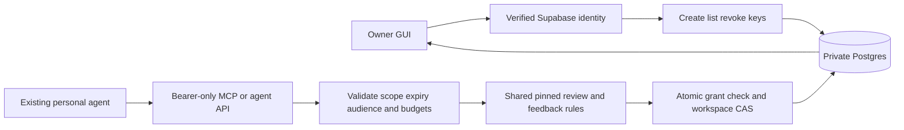

# Accountless entry and optional hosted personal-agent access

`angbao agent` and `angbao mcp` default to the private loopback installation, without signup or a token. Start `angbao start`, discover with `angbao agent doctor`, read the necessary saved context and run a supported pinned review with the current ETag and a non-secret operation key. The same installation retains settings, reviews and structured authored research across restart. GUI inspection is optional. See [installation](CLI-DISTRIBUTION.md).

Hosted access below is explicitly selected with `--hosted` or `--origin HTTPS_ORIGIN`; environment variables alone do not select it. It retains authenticated private APIs, scopes, budgets and revocation. Do not remove auth or use provider keys to make a guest route. Local data is carried forward only through authenticated claim preview and explicit owner confirmation in Agents. Failed/declined signup preserves local use. Credentials, grants, simulated entitlements and financial permissions are excluded; one-time import does not enable sync or execution.

# Angbao personal-agent access

**24 October 2026.** Implemented in portable source, with migration and rollback-only PostgreSQL acceptance passed. Production activation is off. A configured human sign-in → key creation → real external agent → shared GUI flow has not yet been accepted on a deployed host.

## Integration decision

Use a short agent skill for instructions, MCP for live tools, and a thin CLI as a terminal fallback. Keep one server contract and one owned history. A Markdown file can teach usage; it cannot authenticate an agent, enforce a limit, verify a financial source or keep a job running. Angbao does not need to replace the person's existing reasoning harness.

The local CLI remains an independent loopback workspace. A hosted personal token accesses the hosted owner's records. Installing a skill or copying a local archive does not merge these stores. The installation kit makes the target explicit rather than silently switching between them. Use [CLI-DISTRIBUTION.md](CLI-DISTRIBUTION.md) for the human quickstart and [the agent skill](integrations/angbao/SKILL.md) for portable usage instructions. One chosen connection path is sufficient; native remote MCP may not need the CLI.

## Why this is the entry point

The person keeps the harness and model they already use. A small instruction skill improves tool selection without creating another chat interface. The backend provides shared context, exact strategy versions, saved reviews and owner-controlled access; the GUI makes those records and controls visible. This supports the free installation wedge while leaving the broader product scope intact.

The skill/CLI is a distribution surface, not the moat or a completed recurring service. Test whether a first useful review leads to a return visit with changed context. Advanced configuration, dependable monitoring/recovery and later sharing/licensing must earn payment through demonstrated value. A paid plan cannot expand scopes or create financial authority, and installation does not start a background job. Do not build another reasoning harness simply to distribute these tools.

Use one supported method per client. The release includes generic configuration and instruction files, but real compatibility requires a named harness/version, tested transport, secret configuration and last accepted result. Manual tokens are an assisted pilot route; a consumer Connect flow needs a separately reviewed OAuth/onboarding design.

## Owner and agent flow

1. The owner signs in to the independently hosted Angbao GUI. Browser APIs verify the Supabase user on every request.
2. In Agents, load access availability. If the server reports unavailable, show requirements rather than a working connection.
3. The owner chooses a key name, scopes, expiry and budgets, explicitly consents, and creates a key. The secret is shown once in a temporary dialog. Closing it clears the client reference; list/revoke remains the recovery path if creation completed but delivery was interrupted.
4. The owner places the key in their harness's secret mechanism. The agent uses bearer authentication against `/mcp` or `/api/agent`; browser cookies and claimed identity headers do not authenticate these endpoints.
5. The agent discovers permitted tools, reads only the approved context, and creates an exact pinned review when requested. The resulting record appears in the owner's normal GUI history with origin `Personal agent` and the grant ID. A user-chosen key label does not verify the harness's identity.

The GUI retains configuration, inspection, feedback and revocation. The headless path performs narrow commands against the same versioned records. Neither path can trade, transfer, sign or schedule unattended work in this release.

## Current tool contract

| Tool | Scope | Result and boundary |
|---|---|---|
| `angbao_list_strategies` | Any valid key | Immutable built-in pins/settings; no private financial read |
| `angbao_read_workspace` | `workspace:read` | Saved sample/manual context and installed strategies, plus current ETag; no billing or credentials |
| `angbao_read_history` | `history:read` | At most 20 retained reviews and their decisions/feedback; bounded output, not a complete proof ledger |
| `angbao_run_strategy` | `reviews:create` plus `workspace:read` | Explicit strategy ID/version, optional validated settings, ETag and idempotency key; one calculation review, no financial action |
| `angbao_submit_feedback` | `feedback:write` | Explicit feedback for a retained owned review, ETag and idempotency key; no automatic usefulness rating |

`/api/agent` accepts `POST {"tool":"<name>","arguments":{...}}`. `/mcp` offers a stateless JSON response transport for protocol `2025-06-18`: initialize, initialized notification, ping, tools/list and tools/call. Manual personal-token setup is supported; OAuth discovery, dynamic registration, automatic harness setup and a universal tested-client compatibility claim are not supported.

For a write, first obtain the current ETag through an authorized read. Bind a stable idempotency key to the exact intended command. An unchanged retry returns the original operation; a changed command needs a new key. A stale revision requires fresh context and reconsideration. Never blindly replay a future external financial submission merely because an API retry is safe for the present calculation.

## Permissions and limits

| Control | Current implementation |
|---|---|
| Secret | Random 256-bit component; SHA-256 digest only at rest; raw key returned once, never in workspace exports/history/receipts |
| Expiry | Owner selects 1–720 hours; database clock enforces expiry |
| Scopes | Context read, history read, create review, submit feedback; review creation requires context-read consent |
| Request budget | 1–1,000 lifetime requests per key, including discovery/reads/retries; 30 requests per minute |
| Review budget | 0 for read-only keys; 1–100 unique committed reviews for review-enabled keys; total request budget must cover it |
| Key count | At most 10 active and 100 stored keys per owner; an audited cleanup/retention path is required before removing the lifetime stored-key cap |
| Audience | Bound to configured canonical HTTPS origin, supplied by the server |
| Revocation | New requests and atomic write commits reject revoked/expired keys. Already authorized reads may finish. Previously committed records remain visible to the owner. |

Key creation/list/revoke has a separate browser-authenticated API and does not change workspace ETags. Mutation requests require the canonical Origin and the verified owner's `X-Workspace-User` guard. A missing/forged owner header cannot choose another person's key.

Each agent write validates its scope, expiry, revocation and budget inside the same PostgreSQL transaction that commits the workspace revision and a per-key replay receipt. This keeps an uncertain retry from consuming another review allowance. Request budgets are a software access limit, not permission to spend money, model tokens, data credits or gas.

## Architecture and configuration

Required backend configuration remains `SUPABASE_URL`, `SUPABASE_PUBLISHABLE_KEY`, server-only `SUPABASE_SECRET_KEY` or legacy service-role key, and exact HTTPS `ANGBAO_APP_ORIGIN`. Additionally, `ANGBAO_PERSONAL_AGENT_ACCESS_ENABLED=true` enables the personal-token routes. Leave this flag off until the deployment acceptance below passes. There is no browser-facing server key.

The append-only migration `supabase/migrations/20261024000200_personal_agent_access.sql` adds private `agent_grants` and `agent_operations`, RLS and one fixed service-only RPC, `public.angbao_agent_v1`. Browsers cannot execute it directly. The owner GUI uses authenticated server routes, not direct table access. An empty `search_path`, schema-qualified objects and explicit EXECUTE revokes protect the intentional SECURITY DEFINER boundary.

## Verification and remaining launch gates

On 24 October, the migration and `supabase/tests/personal-agent-access.sql` passed on the existing Angbao PostgreSQL project. Tests covered secrecy/projection, ownership, audience, database-clock expiry, budgets, CAS, replay and actual anon/authenticated execution denial. Readback confirmed RLS on both new tables, service-only RPC permission and zero retained QA rows. A real public-key HTTPS request to the new RPC returned HTTP 401 / PostgreSQL `42501`, as required.

The combined source, including the installation kit, passed 221 tests, TypeScript, syntax checks and the default Next.js Turbopack production build. A clean offline install of the final 0.2.0 archive verified the installed command help, copied skill, packaged docs and overwrite refusal. Qualitative instruction review covered discovery, saved pin/settings selection, uncertain-write recovery and unearned feedback; its review prompts are not an executed model benchmark or named-harness verification. Concurrent retry/revocation behavior is fixture tested; the single rollback SQL session is not an inter-session concurrency proof.

Still required before enabling live access: chosen host and secure server configuration; real human/session and two-owner acceptance; actual browser-created key → external agent → GUI/revoke test; ingress rate controls against invalid-token traffic; two-session database contention/recovery checks; and audited deletion/retention operations. No real token or production financial grant was created by the database acceptance. Provider, payment and Robinhood Chain authority remain separate gates.
