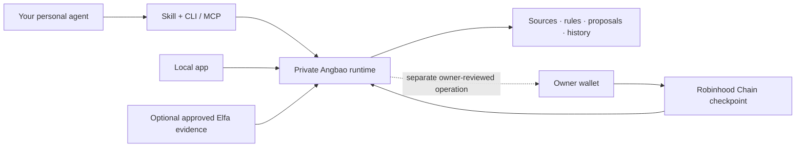

# Angbao

**Financial context for the personal agent you already use.**

Bring research and a dated portfolio snapshot. Review a contribution or allocation proposal with its evidence, assumptions and gaps. Save the decision, compare it with earlier work, and pick it up again through the CLI, MCP or local app.

**Start with a useful review. Earn permission to do more.** Local use needs no Angbao signup, card, broker connection or wallet.

[Website and installation](https://www.angbao.money/) · [First useful result](docs/getting-started.md) · [Architecture](docs/architecture.md) · [Business strategy](docs/business-strategy.md) · [Testnet evidence](docs/submission-evidence.md)

## Understand Angbao without watching the video

Read the **[product overview](docs/product-overview.md)** for the problem, a complete example, the trust model, Robinhood Chain's role and the path to a business. The **[full feature map](docs/feature-map.md)** retains all 57 feature families, with a clear distinction between the working submission, foundations and future work.

| Time available | Suggested review |
| --- | --- |
| Two minutes | This README and the [current product table](#what-can-i-use-today) |
| Five minutes | [Product overview](docs/product-overview.md) and [actual testnet evidence](docs/submission-evidence.md#robinhood-chain-proof) |
| Technical review | [Run a local trial](docs/getting-started.md), then [architecture](docs/architecture.md) and [contract build](docs/development-and-release.md#reproduce-the-fixed-contract-build) |
| Venture/product review | [Customer, pricing, GTM and moat thesis](docs/business-strategy.md), then the [complete feature map](docs/feature-map.md) |

## Pitch and demonstration

[Watch the founder pitch and product demo](https://www.angbao.money/submission.html) · [Pitch PDF and Product/GTM canvases](https://www.angbao.money/media/angbao-founder-pitch-20261025.pdf) · [Editable PowerPoint](https://www.angbao.money/media/angbao-founder-pitch-20261025.pptx)

The 3:20 founder pitch uses actual app captures. The separate 1:06 demonstration uses sample portfolio inputs and a retained real testnet checkpoint; no new transaction occurs during recording. The appendix preserves all original Arbitrum Product/GTM canvas questions.

## What can I use today?

| Part | What it does in 0.5.11 |
| --- | --- |
| **Personal-agent tools** | A project skill, CLI and optional stdio MCP bridge. Your existing agent supplies reasoning; Angbao stores the financial work. |
| **Research** | Retain supplied sources, a separately authored assessment, supporting and contrary evidence, assumptions and missing information. An optional owner-configured Elfa profile can bring in bounded source evidence. |
| **Portfolio review** | Check manually supplied or labelled sample values against selected targets and owner rules; calculate a proposal. Keep/watch/research are useful outcomes too. |
| **Local app** | Inspect the same saved reviews, briefs and proposals used by the agent. Preview before saving; compare earlier work; archive and export. |
| **Continuity** | Reopen exact saved records after restart and provide a reference to another agent already authorized for the same workspace. |
| **Robinhood Chain demo** | An owner-approved decision fingerprint recorded in Angbao's own contract on Robinhood Chain Testnet, with retained receipt and recovery. |

A proposal is not a trade. The current contract records a decision checkpoint; it does not enforce a spending policy. Live broker/bank connections, cross-installation sync, hosted subscriptions, unattended jobs, multiplayer and capped/revocable smart-account execution are **future delivery**, not included in this release. [Full status and evidence](docs/submission-evidence.md).

## Try the source in a clean workspace

Requires **Node.js 22.13.0 or newer**. This local runtime has **zero npm dependencies**; there is no `npm start` or registry package to install.

```sh
git clone https://github.com/ryanteoyx/angbao-robinhood.git
cd angbao-robinhood
node --version
node cli/angbao.mjs --help
taskReviewData=$(mktemp -d /tmp/angbao-review.XXXXXX)
env ANGBAO_DATA_DIR="$taskReviewData" node cli/angbao.mjs start --port 4317
```

Leave that terminal running. Open **http://127.0.0.1:4317/** and choose **Try a savings review** or **Try a portfolio check**. These are labelled examples. In a second terminal in this repository:

```sh
env ANGBAO_API_URL='http://127.0.0.1:4317' node cli/angbao.mjs agent doctor
env ANGBAO_API_URL='http://127.0.0.1:4317' node cli/angbao.mjs agent sample preview --preset try-savings
```

Preview does not save. The [getting-started guide](docs/getting-started.md) covers an explicit save, history, restart, export, agent/MCP connection and troubleshooting. The directory above is a disposable **trial**: record the printed path if you want to restart it, and choose persistent storage before keeping personal work. Never start two writers for the same data directory.

For normal installation, give your agent the [public installation guide](https://www.angbao.money/angbao-install.md). Its live manifest selects the verified release and checksum. The installer does not activate a provider or wallet, edit global agent configuration, or create an account. macOS/Linux with compatible Node, npm and curl are the supported bootstrap path; Windows has not been accepted.

## Understand the system



Research, reasoning handoff, calculation and memory are **offchain**. The onchain demo records an opaque commitment and event. Personal portfolio text, research bodies and the private opening stay offchain. [Architecture and trust boundaries](docs/architecture.md).

## Read by role

| I want to… | Read |
| --- | --- |
| Install, run and keep my first result | [Getting started](docs/getting-started.md) |
| Connect an existing personal agent | [Getting started: agent and MCP](docs/getting-started.md#use-your-existing-agent), then the [packaged skill](integrations/angbao/SKILL.md) |
| Understand what is offchain/onchain and find modules | [Technical architecture](docs/architecture.md) |
| Understand the wedge, pricing, distribution and moat thesis | [Business strategy](docs/business-strategy.md) |
| Review the exact contract, transactions and current limits | [Submission evidence](docs/submission-evidence.md) |
| Reproduce a check or contribute a bounded change | [Development and release](docs/development-and-release.md) |

## Source and provenance

This is a clean **source-available submission snapshot**, not the private development repository or its history. The 0.5.11 runtime/UI/skill comes from development commit `6e1dc8dd36f64f63e568956928e3fb6bd027f10a`; the initial public snapshot is `40cded3d7bd43100b378fb391a7676362175b75f`. Documentation updates can advance this repository without changing that release. The archive is 659,174 bytes; SHA-256 `febde006ba467da6b8a7904c44e69039009b79555c3f1d88284d361327ced0f5`.

Existing source headers and third-party notices are retained. No repository-wide license grant has been added; do not assume that public visibility grants unrestricted reuse. `AngbaoCommitment.sol` carries its own MIT SPDX header. This repository includes no credentials, personal workspaces, private openings or transaction journals.

Status is dated **25 October 2026**. Proposed services and ecosystem support are hypotheses, not launched plans or partner commitments.
