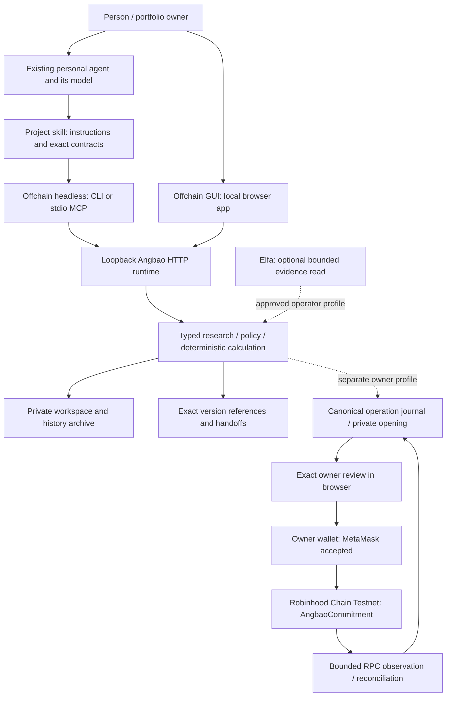
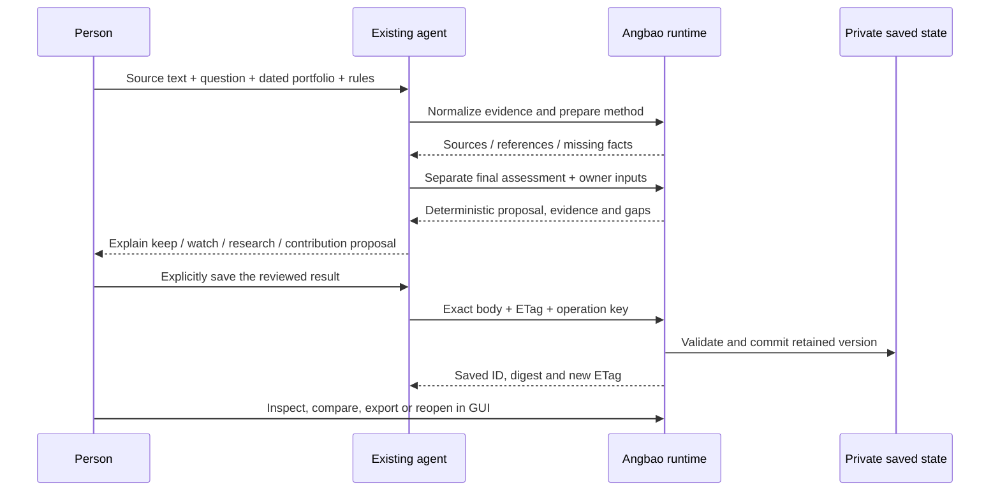

# Technical architecture

[← Angbao](../README.md) · [Start locally](getting-started.md) · [Evidence](submission-evidence.md) · [Development](development-and-release.md)

**Angbao is the record and control boundary between a personal agent and financial work.** The agent supplies reasoning. Angbao retains explicit context, evidence, method versions, deterministic proposals, owner decisions and outcomes. A human can inspect the same work in a GUI without moving into a second workflow.

This describes the **0.5.11 public snapshot**. A module present in source is not automatically an enabled service. Current behavior and planned additions are labelled throughout.

For the complete user story, read the [product overview](product-overview.md). The [57-family feature map](feature-map.md) keeps the broader scope visible without presenting roadmap items as delivered architecture.

## 1. System map

The first path is useful without the lower wallet path. CLI, MCP and GUI are clients of the same runtime. None is a second source of portfolio truth.

## 2. Name each part and find its code

| System part | Responsibility | Main paths |
| --- | --- | --- |
| **Offchain headless — CLI** | Startup, local connection, preview/save/read/export, exact handoff, owner-local operator entry points | [`cli/angbao.mjs`](../cli/angbao.mjs), [`cli/local.mjs`](../cli/local.mjs), [`cli/remote.mjs`](../cli/remote.mjs) |
| **Offchain headless — MCP and skill** | Typed agent tools; teach the agent what to read, ask and preserve | [`cli/mcp-bridge.mjs`](../cli/mcp-bridge.mjs), [`integrations/angbao/SKILL.md`](../integrations/angbao/SKILL.md) |
| **Offchain GUI** | Context, research, proposals, saved history/comparison and optional owner review | [`ui/index.html`](../ui/index.html), [`ui/app.js`](../ui/app.js), [`ui/research-authoring.mjs`](../ui/research-authoring.mjs), [`ui/review-comparison.mjs`](../ui/review-comparison.mjs) |
| **Offchain runtime/API** | Route validation, single workspace composition, persistence and response contracts | [`server/server.mjs`](../server/server.mjs), [`src/server/local-history-store.mjs`](../src/server/local-history-store.mjs) |
| **Research and methods** | Separate sources, claims, inference, counterevidence, gaps and exact method/work versions | [`research-briefs.mjs`](../src/domain/research-briefs.mjs), [`research-method.mjs`](../src/domain/research-method.mjs), [`research-work-record.mjs`](../src/domain/research-work-record.mjs) |
| **Portfolio calculation** | Validate dated inputs, typed instruments, targets/policy and assessment; calculate a bounded proposal | [`portfolio-decision.mjs`](../src/domain/portfolio-decision.mjs), [`portfolio-work-record.mjs`](../src/domain/portfolio-work-record.mjs), [`research-portfolio-bridge.mjs`](../src/domain/research-portfolio-bridge.mjs) |
| **Financial memory** | Resolve exact saved business records and scoped references; retain lineage rather than private model reasoning | [`financial-memory-contract.mjs`](../src/domain/financial-memory-contract.mjs), [`financial-memory-resolver.mjs`](../src/domain/financial-memory-resolver.mjs), [`financial-handoff.mjs`](../src/domain/financial-handoff.mjs) |
| **Optional Elfa integration** | One-shot evidence preview/consent/admission/fetch/status and private retention | [`cli/local-elfa.mjs`](../cli/local-elfa.mjs), [`headless-elfa-evidence.mjs`](../src/server/headless-elfa-evidence.mjs), [`local-elfa-runtime.mjs`](../src/server/local-elfa-runtime.mjs), [`elfa-research.mjs`](../src/integrations/elfa-research.mjs) |
| **Onchain preparation and recovery** | Select an exact native record, prepare scoped commitment, custody private opening, review, journal and reconcile | [`decision-checkpoint.mjs`](../src/domain/decision-checkpoint.mjs), [`local-checkpoint-coordinator.mjs`](../src/server/local-checkpoint-coordinator.mjs), [`local-checkpoint-controller.mjs`](../src/server/local-checkpoint-controller.mjs), [`local-owner-transaction-journal.mjs`](../src/server/local-owner-transaction-journal.mjs) |
| **Onchain frontend** | Correlate wallet provider/session, account/network, immutable review and retained operation; keep signing separate | [`ui/checkpoint-review.mjs`](../ui/checkpoint-review.mjs), [`ui/wallet-provider.mjs`](../ui/wallet-provider.mjs) |
| **Onchain contract** | Store a nonzero, write-once commitment per sender/operation and emit its event | [`contracts/AngbaoCommitment.sol`](../contracts/AngbaoCommitment.sol), [`build artifact`](../contracts/angbao-commitment.build.json) |
| **Durable job foundations — OFF** | Bounded job/mandate/lease/result/reference protocols; no worker starts in the default local product | [`managed-job-ledger.mjs`](../src/domain/managed-job-ledger.mjs), [`managed-job-runner.mjs`](../src/server/managed-job-runner.mjs), [`local-managed-job-binding.mjs`](../src/server/local-managed-job-binding.mjs) |

There are no npm runtime dependencies. Pinned vendored encoding libraries and notices are under [`src/vendor`](../src/vendor); reproducible contract tools are isolated under [`scripts/checkpoint-tooling`](../scripts/checkpoint-tooling/README.md).

## 3. The useful offchain flow

**A source URL is not source content.** Supplied excerpts and Elfa-derived summaries keep their provenance and dates. A provider summary is not an original X post; link-only citations stay link-only. Agent prose cannot silently change an owner policy or manufacture positions. The bridge binds the exact retained brief/evidence/work versions to a separate typed assessment before calculation.

**Reasoning and calculation have different owners.** The existing agent authors the final assessment. Deterministic modules validate inputs and calculate supported proposals; they do not replace missing data with persuasive prose. No default local research/review call invokes a model or fetches an external provider.

**Save is an effect.** Preview/normalization does not save. A native write uses a quoted numeric ETag for optimistic concurrency and a non-secret idempotency key. Exact replay can return the original result; changed payloads or stale conflicting revisions fail. A timeout is uncertain until inspected, not permission to retry with a new identity.

## 4. Data, portability and custody

| Record | Retain | Never infer from it |
| --- | --- | --- |
| Context / snapshot | Owner-supplied cash, goals, dated values, units, source and limits | Verified bank/broker positions, prices or account ownership |
| Method / research work | Exact pin/settings, sources, authorship, timestamps, counterevidence, gaps and predecessor | A method's correctness, return or source truth |
| Portfolio proposal | Exact assessment, inputs/targets/policy refs, calculated result and comparison | An order, reservation, automatic purchase or permission |
| Handoff / memory ref | Workspace/record identity, version/digest and selected baseline | Access rights, cross-installation sync or a hidden agent conversation |
| Feedback | Explicit owner rating/correction on a saved result | Realized investment performance or permission to train on private data |
| Chain operation / receipt | Exact reviewed terms, journal state, hashes and observations | Finality before observation or another permitted send |

The normal source CLI stores the native workspace at **`ANGBAO_DATA_DIR/workspace.json`**, defaulting to `~/.angbao/workspace.json` on the executing computer. Keep that path separate from versioned programs. Run one writer per workspace; protected/client/operator stores have separate private paths. A private directory protects against other OS users, not another process with the same OS identity.

Native history is bounded: five active and 64 archived portfolio proposals, with per-record limits. Archive/export retain earlier exact baselines rather than silently dropping them. Full native export is distinct from the narrower optional hosted-claim format. Export/import do not carry bearer tokens, source credentials, wallet authority or permission to replay an operation.

Current portability is **exact-record continuation for separately connected clients of one workspace**, plus explicit export. Automatic merge/conflict synchronization across installations, instruments and venues is a future service. Pi Durable was investigated separately; it is not the shipped runtime or a claim that Angbao can resume another harness's private model session.

## 5. What Robinhood Chain adds

Robinhood documents an EVM-compatible network focused on financial assets and account abstraction. That makes it a plausible first home for programmable financial controls. It is not a unique cryptographic dependency or a promised brokerage distribution channel. [Robinhood overview](https://docs.robinhood.com/chain/).

Current demo chain: **Robinhood Chain Testnet, ID 46630**. Do not substitute mainnet ID 4663. Network endpoints are selected through reviewed runtime configuration, not untrusted source text. Public RPC is rate-limited; a production service requires a reviewed provider route. [Network documentation](https://docs.robinhood.com/chain/connecting/).

### Current contract: a decision checkpoint

1. Select an exact saved native portfolio record and its policy/version/digests.
2. Prepare a commitment scoped to chain, owner, contract and operation reference using a cryptographically random private salt.
3. Custody the private opening before a wallet operation. A public export omits native financial detail and the opening.
4. The owner separately reviews deployment and commitment operations, including account/network, call, value, nonce, expiry and fee caps.
5. Reserve/retain the canonical operation identity, request wallet confirmation and preserve uncertain or late hashes.
6. Observe the exact transaction/receipt/event/runtime through the allowed read plan, then retain it for restart/recovery and redacted export.

`AngbaoCommitment.commit(bytes32 operationRef, bytes32 commitment)` rejects nonzero native value, zero reference/commitment and overwriting an existing sender/reference pair. It emits `Committed` and exposes the stored commitment. **It does not call a broker, execute an allocation, verify research, enforce a spending budget, manage a session key or produce a ZK proof.** Gas/review expiry/revocation and journal checks in this demo are application/wallet controls, not additional Solidity rules.

An opaque salted commitment can support later consistency checking against retained material; it does not establish that the private input was truthful or that its disclosure is safe. Public sender/timing/contract activity remain observable.

### Next control primitive — not shipped

A compatible smart account must enforce the allowed token/contract/function/recipient, cumulative amount budget, expiry and replay rules **at execution**, with effective owner revocation. Test denied calls and revocation after interruption, not only the happy path. Offchain broker actions need separate venue scopes and cannot be governed by a Robinhood Chain contract.

## 6. Provider roles

| Provider / component | Role | Accepted use / boundary |
| --- | --- | --- |
| **Personal agent / its model** | Final synthesis and explanation | User supplies their existing agent/model; Angbao does not host or automatically call one. |
| **Elfa** | Optional source discovery/context evidence | One approved v3 Events fetch was accepted in the installed trial. Setup/credits are not unlimited rights or a current account-wide cost guarantee. Fetch, final synthesis and native save remain separate. |
| **Robinhood RPC** | Chain identity/state/transaction/receipt observations | The accepted checkpoint used the official testnet RPC with finite reviewed reads. No new reads are required to show the retained evidence. |
| **QuickNode** | Alternative configured RPC/archive/event infrastructure | Not a dependency used by the accepted checkpoint. Capacity/credits and chain/method support need current verification. [Provider page](https://www.quicknode.com/chains/robinhood). |
| **ZeroDev / Kernel** | Smart-account, permission and bundler/paymaster tooling | Modules retained; live delegation, sponsorship and restricted execution not accepted here. ZeroDev's documented permission plugins are building blocks, not Angbao's completed security model. [Permissions](https://docs.zerodev.app/smart-accounts/permissions/intro). |
| **Supabase / hosted adapter** | Optional separately configured account persistence/access | Not needed for local use. Hosted SMTP/auth/two-owner acceptance and managed sync remain open. |
| **Stripe** | Future commercial entitlement/payment rail | Account/setup does not establish paid fulfillment; no local command creates a live subscription. |

## 7. Trust and failure model

| Risk | Current boundary | What still needs work |
| --- | --- | --- |
| Untrusted article/tool text changes instructions | Source text remains data; typed assessment, provenance and owner policy are separate | Adversarial testing across each real personal-agent harness; no prompt-only safety claim |
| Wrong portfolio or stale valuations | Manual/sample labels, timestamps, gaps and policy references | Accepted live account/valuation/corporate-action connectors |
| Lost/conflicting save | Exact ETag, retained operation key/body, versioned results, archive/export | Managed multi-device conflict resolution, backup/deletion drills |
| Local client reads another user's data | Loopback-only default and explicit protected read-only mode | Default local mode is not a multi-tenant service; same-UID isolation is not provided |
| Duplicate wallet effect after timeout | Canonical journal/nonce hold, original request/hash retained and reconciliation | Further chain/venue acceptance before broader financial actions |
| Wallet account/network/session changes | Exact reviewed challenge and invalidation before send; late result retained with original operation | Additional named wallet acceptance; MetaMask is the accepted demo route |
| Provider failure or uncertain usage | Bounded one-shot consent and reserve-before-call; no automatic paid fallback/refetch | Key-wide budget ownership, rights and charging verification for each deployment |
| Worker restart/revocation | Job/memory/journal foundations in source | Jobs remain OFF; supervised service, store ownership and live end-to-end operational acceptance required |

## 8. Deployment boundaries

- **Public site:** static installation/media distribution; no private financial workspace should be published there.
- **Local runtime:** Node process with durable private disk and loopback-only browser/API. It runs on the computer chosen at installation, which may be an agent VM.
- **Hosted app:** separate work. An anonymous login page or protected API 401 is not accepted sign-in, owner isolation, sync or reliability.
- **Future jobs:** a supervised worker with durable storage, bounded tools/resources, mandates, fencing, cancellation and outbox/inbox recovery. A frontend/serverless deployment alone is insufficient.
- **Onchain:** owner wallet signs; the network supplies public execution evidence. Research/model/private-memory work remains offchain.

The public snapshot is for inspectable local use and reproducible contract building. See [development/release](development-and-release.md) for reproducible commands and the explicit missing-test-suite boundary.
