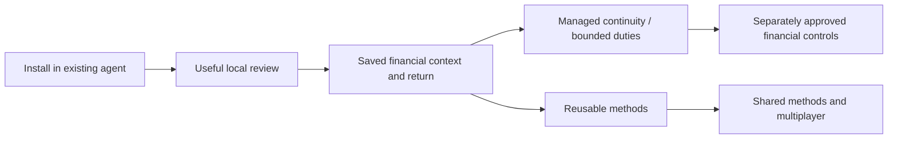

# Product and business strategy

[← Angbao](../README.md) · [Architecture](architecture.md) · [Current product and evidence](submission-evidence.md)

**Thesis:** people will increasingly use personal agents to manage financial work. The product should first help them understand a decision, retain the context and verify an outcome. Broad autonomous trading comes after earned trust and enforceable permissions.

This is a startup thesis to test, **not evidence of product-market fit**. Prices, funnels, sponsor asks and network effects below are proposed. No revenue, partnership, brokerage distribution or live managed subscription is claimed.

## 1. Who needs this first?

| Question | Initial answer to test |
| --- | --- |
| User | A person already using a personal agent for research, with money spread across at least two accounts or asset types. |
| Buyer | Initially that person; later a small team/creator only if a real shared workflow emerges. |
| Repeated job | “Does this article or market change affect my contribution/allocation plan, given my portfolio and rules?” |
| Current workaround | Chat + spreadsheets/notes + broker/wallet apps, with context and earlier decisions manually reassembled. |
| Failure that matters | An attractive idea is sized without the full portfolio, a rule is forgotten, or the agent cannot explain what changed since the last review. |
| First useful result | A source-linked proposal or an explicit keep/watch/research outcome, saved with assumptions and missing inputs. |
| Entry point | Install a small financial tool/skill into the agent the user already trusts. No Angbao signup before that first result. |
| Initial proof to seek | Independent setup, useful saved result, correct return at the next natural review, and willingness to pay for a specific maintained duty. |

Start with people who can supply a dated snapshot and one real research question. “Everyone with money” is a destination, not an acquisition segment. Broader nontechnical users need accepted onboarding, simpler data intake and trust in the result before they are a credible early market.

## 2. Why start before autonomous trading?

A trading action is downstream of account truth, objectives, evidence, calculation, permission and recovery. Starting with an unrestricted trading agent combines those uncertainties before the user has seen value. A research-to-portfolio review lets Angbao demonstrate useful work without asking for custody, a broker key or a funded wallet.

Savings/contribution review is an **entry wedge**, not the company's final category. It is frequent enough to revisit and has visible inputs/constraints. A keep/watch decision can be successful; transaction count should not become the incentive for the product.

The analogy with levels of driving autonomy is a communication device, not a safety certification. Angbao must demonstrate each permission and denial in its own financial setting.

## 3. Product structure

| Layer | Role in the business | Current boundary |
| --- | --- | --- |
| **Single player** | Solve one person's recurring decision; learn what context and corrections matter | Local sources, proposals, history and export work with supplied/sample inputs |
| **Multiple agents for one person** | Let research/calculation/review roles use the same exact business record rather than disconnected chats | Typed memory/handoff foundations and one actual named-harness acceptance; no universal orchestration claim |
| **Managed continuity** | Remove maintaining a private runtime, backups, conflicts and reconnects | Proposed paid service; hosted sync/owner isolation are not launched |
| **Bounded operation** | Carry out a specific background research/review duty with a cost ceiling and recoverable result | Durable foundations in source, Jobs OFF; fulfillment must precede sale |
| **Financial permission** | Allow narrowly defined actions after explicit owner review and execution-enforced limits | Decision checkpoint works on testnet; spend permission is next |
| **Multiplayer** | Share/install a method while each user keeps their own context, policy and authority | Roadmap; marketplace/reputation/shared-budget claims are not delivered |

The GUI is a control and inspection surface. It should not require a user to rebuild their agent workflow in another chat product. Methods should be easy to install/reuse; arbitrary drag-and-drop strategy graphs are not a delivered runtime in this snapshot.

## 4. What stays free, when sign-in happens, what users pay for

| Offer | Free / account boundary | Paid outcome / gate |
| --- | --- | --- |
| **Local** | No signup: manual/supplied-source research, calculation, local save/history, archive, inspection, exact-work handoff and export | Remains useful independently of a subscription. Current storage bounds are safety limits, not a paywall. |
| **Continuity — proposed USD 12/month** | Sign in only when choosing a managed destination | Maintained sync/recovery/backup and continuation across supported installations. Must pass real auth, two-owner isolation, conflict/deletion and restore acceptance first. |
| **Operations — proposed +USD 24/month** | Explicit service mandate, approved duty/resources/expiry; separate from sign-in | Bounded background research/review and reliable return/recovery. Must fulfill jobs, caps/cancel/revoke and uncertain-call recovery first. |
| **Premium methods — later** | Discover a method before purchasing; local context stays portable | A versioned maintained method or creator licence with observable value. Pricing, refunds, creator economics and eligibility remain untested. |
| **Provider/model/gas** | Separately disclosed, owner-authorized resources | Not implicitly unlimited or included. No surprise paid fallback; financial permission is never purchased by a subscription. |

The source's historical `--managed`/billing controls are simulations, not these live offers. Do not place the proposed prices in a checkout or collect payment before the promised service operates. A successful Stripe setup is not a delivered entitlement lifecycle.

Monetization should follow a repeated job: a user returns, understands the useful record, then chooses maintained continuity or a specific duty. Signup before the first local result would reduce the advantage of the installation wedge.

## 5. Whitespace and competitive playbooks

The target gap is the **reliable financial work record** between a general agent and financial tools: exact inputs/method/source/policy versions, unresolved work, explicit owner authority and reconciled outcomes. It is narrower than “AI finance” and stronger than a prompt or wallet wrapper—if users repeatedly need it.

| Substitute / playbook | What to learn | Where Angbao must be distinct |
| --- | --- | --- |
| **Agent's memory + files/spreadsheet** | The simplest, cheapest baseline; flexible and already installed | Faster correct return, preserved rules and fewer lost/conflicting decisions. Generic storage is not enough. |
| **Coinbase AgentKit / wallet tools** | Reuse tools that supply wallet/onchain actions; do not reinvent them | Own the portfolio/context/evidence/review/continuity contract around an action. [AgentKit source](https://github.com/coinbase/agentkit). |
| **Robinhood-native agent experience** | A distributor can put tools into an existing customer journey | A cross-harness record may complement a venue. Robinhood Agent Apps are documented only for Robinhood-hosted agents; admission is unverified. [Agent Apps](https://robinhood.com/us/en/support/articles/agent-apps/). |
| **ZeroDev / account permissions** | Compose existing signers, policies and actions | Correct financial context and recoverable user workflow around enforceable controls, rather than claiming session keys as an invention. [Permissions](https://docs.zerodev.app/smart-accounts/permissions/intro). |
| **Obsidian-style maintained continuity** | People can retain local files while paying for sync/history/convenience | Finance-specific provenance, conflict/recovery and accepted agent continuation must justify a premium over generic sync. [Obsidian Sync](https://obsidian.md/sync). |
| **High-frequency chain trading apps** | A narrow repeated job can drive retention when assets, liquidity and distribution support it | Transfer the complete-job discipline, not an assumed demand for faster trading on a different chain. Angbao's selected job is decision continuity. |
| **Agent skill/service markets** | Distribution through an already installed agent can lower activation friction | Useful repeat outcomes and sustainable unit economics before a token, marketplace or referral incentive. |

These are product lessons and hypotheses, not an exhaustive competitor ranking or claims that any provider lacks all of Angbao's planned features. Platform incumbents can add memory and controls. Angbao must win by serving more than one harness/venue with demonstrably better continuity, not by assuming platforms will ignore the problem.

## 6. Why Robinhood Chain first?

Robinhood's official chain material describes an EVM financial-asset focus and account abstraction. Angbao can use that environment for explicit programmable controls while keeping research and private financial context offchain. The first accepted checkpoint already makes the chain contribution concrete. [Robinhood Chain](https://docs.robinhood.com/chain/).

**Strategic inference:** a partner may value users arriving from personal agents, understanding a proposed action and progressing into controlled onchain activity. This could support the chain's application ecosystem and help test user-facing account permissions. It is a reason to propose a design-partner experiment, not proof Robinhood will fund or distribute Angbao.

Keep four routes separate:

| Route | Plausible request | What is not promised |
| --- | --- | --- |
| **Chain technical support** | Review of the next narrowly capped/revocable permission and chain compatibility | Audit endorsement, production security or mainnet launch |
| **Hackathon/grant support** | Bounded validation runway and infrastructure/audit assistance | Selection, funding probability, unrestricted cash or continued subsidy |
| **Wallet/ecosystem discovery** | Small opt-in cohort with install-to-useful-result attribution | Placement or Robinhood brokerage customers by default |
| **Brokerage / Agent Apps** | Admission and integration discussion with the appropriate product team | Brokerage APIs, user data, native billing or third-party distribution rights merely from chain deployment |

Ask first for **one technical reviewer and three design partners**. A later co-marketing/featured-discovery request should include actual independent activation, repeat use and the support needed per user. Do not depend on an uncommitted embedded integration to make acquisition economics work.

QuickNode/ZeroDev credits can reduce a test's cost; they do not create a moat, user demand or permanent margin. A chain integration should remain a bounded adapter so unsupported assets/venues cannot be silently routed through it.

## 7. GTM: independent first, ecosystem support as an accelerator

| Stage | Action | Measure / next gate |
| --- | --- | --- |
| **Three to five pilot users** | Observe one current workaround and one recurring source-to-portfolio question. Help only enough to learn real setup friction. | First independent install, useful saved review, correct return next natural cycle, support minutes. |
| **One accepted agent channel** | Publish a precise install/return guide for the actually tested harness; share through willing maintainers and communities. | Useful completions per install, drop-off causes, exact saved work reused. |
| **Method-led distribution** | Offer a focused evidence-review/contribution method people can install and repeat. | Returned users, corrections, retained methods; not downloads alone. |
| **Ecosystem cohort** | Request a bounded Robinhood/Arbitrum cohort or campaign with attribution and opt-in diagnostics. | Incremental useful users and return after incentives end. |
| **Paid continuity / duty** | Offer only the maintained service whose acceptance is complete. | Fulfilled paid renewal and gross margin after infrastructure, support and refunds. |
| **Multiplayer** | Enable shared methods only after single-user and two-client continuity work. | Independent installs of shared methods, repeat use and feedback with each owner's policy intact. |

Funnel: **discovery → guide opened → environment verified → skill loaded → useful preview → explicit saved result → next-cycle return → chosen managed feature → fulfilled renewal**. Wallet connection, funding and approved onchain activity are a separate optional funnel; they should not obstruct the free first review.

## 8. Potential moat and feedback loop

There is **no established moat today**. The candidate advantage is a trusted financial work graph plus reliable operation across harnesses and venues. It becomes defensible only through:

1. **Useful history:** exact context, method/policy versions, corrections and outcomes that improve the next review. Export remains available; artificial lock-in is not the strategy.
2. **Integration depth:** accepted connectors, clear instrument identities, corporate actions, freshness and explicit venue permissions. A list of planned logos is not this depth.
3. **Operational evidence:** proven recovery, denial/revocation, conflict handling and understandable owner review across real clients.
4. **Reusable methods:** versioned methods whose corrections and usefulness improve through opt-in feedback. Popularity and investment performance must not be conflated.
5. **Distribution relationships:** a track record of useful retained users that earns renewed partner support, rather than a single grant.

The loop is **use → retained decision → explicit correction/feedback → better method/onboarding → more useful next review → natural return**. Collect only consented structured diagnostics and explicit ratings. Do not sell private portfolio data or store chain-of-thought as a growth asset. Future team/creator network effects require actual cross-user adoption; they are not created by issuing a token or displaying a leaderboard.

## 9. Economics and kill conditions

Do not invent acquisition cost or model margins before measuring them. Per paying user, track revenue net of refunds and payment fees minus storage, worker time, model/data/RPC/gas subsidy and support cost. BYO reasoning reduces one potential cost; it does not remove sync, security, support or provider costs. Paid Operations needs an explicit resource envelope; “unlimited agents” is not a credible cost model.

Proposed learning gates, not traction:

- Of five observed pilots, seek four useful independent completions and three natural-cycle returns after correcting observed onboarding defects.
- Offer ten qualifying returning users the fulfilled USD 12 service; seek three full-price settled purchases net of refunds and two same-price renewals.
- For Operations, require repeated delegation of a real unattended research/review duty and a reason users value recovery over their own cron/agent setup.
- Narrow or stop if return depends on founder prompting, users only want generic chat, context intake costs more effort than it saves, or distribution only works with subsidies.
- Reconsider the chain wedge if users do not need enforceable programmable permission or a verifiable action record. Do not add onchain writes simply to create activity.

A credible build decision is conditional: finish and test the useful local loop, then prove repeat demand and a maintained paid outcome. The current testnet result establishes a technical milestone, not those business proofs.

## 10. Milestones and dependencies

| Next milestone | Acceptance before claiming delivery |
| --- | --- |
| More personal-agent compatibility | Actual install, loaded skill, useful result, exact return/recovery for each named harness |
| Two-client financial continuity | Separate real connections, exact references, stale write rejection and revoked access denial |
| Managed sync / paid Continuity | Auth/SMTP, two-owner isolation, conflict/tombstone handling, restore/deletion and entitlement lifecycle |
| One maintained background duty | Supervised durable worker, mandate/caps, failure/restart/revoke acceptance and no duplicate external effect |
| Robinhood constrained execution | Compatible smart account, allowed calls/recipient/token, cumulative budget, expiry/replay/revocation enforced at execution |
| Broader portfolio truth | Authorized broker/bank/wallet connectors, typed instruments, freshness/valuation and tokenized-asset corporate actions |
| Multiplayer / method revenue | Safe publish/install/versioning, each owner's independent policy, creator terms, abuse controls and real repeat adoption |

Official sources above were checked on **25 October 2026**. Product status refers to the accepted 0.5.11 submission; commercial/distribution conclusions are Angbao's hypotheses.
