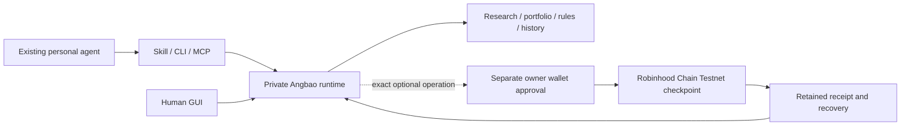

# Angbao: the product in one read

[← Start here](../README.md) · [Try it](getting-started.md) · [Architecture](architecture.md) · [Business strategy](business-strategy.md) · [Full feature map](feature-map.md)

**Angbao gives the personal agent you already use a financial workspace it can return to.** Research, portfolio inputs, rules, proposals and earlier decisions stay together. The person can inspect that same work in a browser and decide what happens next.

This is the written companion to the submission video. It describes the accepted **0.5.11 local product**, its Robinhood Chain Testnet demonstration and the larger product direction. “Working” below means the stated slice has evidence; it does not mean every planned connector or service is available.

## Why start here?

People already ask agents to interpret a market event or investment idea. The hard part is relating the answer to their own circumstances: what they hold, what cash is available, what they are saving for, what limits they set and what they decided last time. Those facts are scattered across conversations, spreadsheets, wallets and financial accounts.

Starting with autonomous trading asks for financial authority before that context has earned trust. Angbao starts earlier: **does this information change my plan, and can I understand and retain the decision?**

Savings and contribution reviews are the entry point, not the final category. The destination is financial coordination across assets, venues and personal agents. Verified account connections and the permissions to act must be added and tested separately. Today, portfolio values are supplied by the user or explicitly labelled as sample inputs.

## A complete example

A person reads a stablecoin article and asks their existing agent whether it changes their allocation plan.

| Step | The person and agent do | Angbao contributes |
| --- | --- | --- |
| 1. Bring context | Supply the article/excerpt, intended decision, time horizon, dated portfolio and personal rules | Retain the inputs, dates, provenance and explicit gaps. A URL alone is not treated as the article's contents. |
| 2. Research | The agent considers the evidence, contradictions and relevance | Keep source evidence separate from the agent's final assessment. Optional, separately approved Elfa evidence can inform the brief. |
| 3. Check the portfolio | Choose the supported allocation/contribution method and confirm inputs | Calculate a proposal against the supplied targets, cash, reserve and other supported limits. Missing holdings are not invented. |
| 4. Review | Inspect the proposed change or a keep/watch/research outcome | Show the relevant context, assumptions and missing information in the same saved-work model used by CLI/MCP and GUI. |
| 5. Save and return | Explicitly save, then revisit through the agent or local GUI | Retain exact versions, compare earlier proposals, recover the same work after restart, archive and export. |
| 6. Optional checkpoint | Separately review an exact testnet wallet operation | Record the saved proposal's fingerprint in Angbao's Robinhood Chain Testnet contract and retain the receipt. |

The outcome may be **“keep the plan”** or **“research further.”** Neither transaction volume nor a persuasive trade recommendation is the measure of success. The current accepted Elfa trial produced a brief/watch outcome; it did not establish live portfolio sizing or an executed allocation.

*Current product, sample data. Saved work is shared by the local GUI and agent tools.*

*Current product, sample data. A proposal is not a trade.*

## Installation is the distribution entry point

The default journey is **install with your agent**, with a terminal path and download fallback. A project skill teaches the agent the workflow; the CLI and optional MCP bridge expose callable tools. The runtime keeps the durable business records on the machine chosen at installation, which may be the user's machine or an agent VM.

The user does not create an Angbao account, connect a broker or fund a wallet to complete the first useful local review. Their existing personal agent supplies reasoning and explanation. Angbao does not require them to move into a new general-purpose chat app or buy another hosted model.

The GUI is the place to inspect history, edit supported settings and review proposed actions. It addresses the same runtime and records as the headless tools. See [installation and first result](getting-started.md).

**Compatibility is specific:** Codex CLI/skill/native MCP has actual acceptance for this submission. Other named harnesses, including Grok Bot, Hermes, Dots and Instinct, need their own current install/use/return tests before a compatibility claim.

## What “portable memory” means

The record should survive a change of chat, agent or model. It contains explicit financial context, dated evidence, method/policy references, decisions, corrections and outcomes. It is not a copy of hidden model reasoning and does not transfer credentials or wallet authority.

Today, supported clients can continue exact saved work in one authorized workspace, and users can export their records. Automatic synchronization across machines and universal cross-harness orchestration are not shipped. A future managed continuity service must handle conflicts, permissions, deletion and recovery without trapping the user's local data.

## Offchain and onchain have different jobs

**Offchain:** research evidence, the agent's final assessment, financial inputs, calculation, memory and orchestration. Private portfolio text and the commitment opening are not published onchain.

**Onchain today:** `AngbaoCommitment` records a nonzero commitment under an operation reference scoped to the sender and rejects overwriting that reference. The founder separately approved deployment and commitment. The exact contract/transactions/event were verified, followed by restart and identical redacted receipt exports. [Contract and transaction links](submission-evidence.md#robinhood-chain-proof).

**Onchain next:** revocable smart-account permissions with allowed assets, destinations and calls, cumulative spend limits, expiry and replay protection enforced at execution. The current contract does not implement those controls, trade or prove returns. A Robinhood Chain contract also cannot grant authority over an external brokerage account.

Robinhood Chain is the first ecosystem focus because its documented financial-asset and programmable-account direction fits this permission milestone. The checkpoint could be built on other EVM chains; deploying it does not grant Robinhood brokerage APIs or distribution. The strategic case is to bring users from personal agents into understandable, controlled financial workflows. That is a partnership proposal, not an agreement already secured.

## Provider roles

| Component | Its job | Current status |
| --- | --- | --- |
| Personal agent/model | Synthesize and explain | Bring the agent already in use; no Angbao-hosted inference requirement |
| Elfa | Optional research evidence | One separately approved v3 fetch accepted; no unlimited entitlement or original-post scraping claim |
| Official Robinhood RPC | Observe the accepted contract, transaction and receipt | Used in the testnet demonstration with bounded reads |
| QuickNode | Potential managed RPC/event infrastructure | Not a dependency used by the accepted checkpoint |
| ZeroDev | Smart-account and permission tooling | Modules retained; live delegation, sponsorship and capped execution are not accepted |
| Pi Durable | Possible bounded execution adapter | Isolated investigation; not the shipped runtime. Product Jobs remain OFF |
| Supabase / Stripe | Potential managed accounts, storage and payments | Separate hosted acceptance and paid fulfillment remain open |

## How this can become a business

The first customer is a personal-agent user who repeatedly assembles research and portfolio context from more than one place. The initial alternative is their agent plus files/spreadsheets and separate account apps. Angbao must make the next review easier and more reliable than that baseline.

| Stage | What stays free | Potential paid value |
| --- | --- | --- |
| Local use, no signup | Supported tools, owned context, manual methods, history, inspection, handoff and export | None required for the first result |
| Deliberate hosted upgrade | Keeping and recovering the user's own local copies | Managed sync/backup/restore across supported installations; proposed USD 12/month |
| Maintained duties | Manual supported runs and owner controls | Reliable bounded background research/review with return/recovery; proposed +USD 24/month |
| Shared methods, later | Independent personal context and authority | Maintained premium methods/creator licences, if repeat demand emerges |

These are pricing hypotheses, not live subscriptions or revenue. Sign-in belongs at the point where a person chooses an available hosted benefit. Paying never grants trading authority. Models, licensed data, provider and gas resources need explicit cost boundaries.

## Single player, multiple agents, then multiplayer

1. **One person:** repeatedly complete a useful review and return to the same decision history.
2. **Several agents for that person:** specialist research, calculation and review roles exchange exact records under explicit scopes and resource limits. Durable recovery must preserve the same job and avoid duplicate effects.
3. **Several people:** publish/install versioned methods while each person retains their own portfolio, policies and approvals. Add collaboration, attribution and qualified feedback only after that independent loop works.

Strategy discovery, leaderboards, reputation, verified performance and genuine ZK proofs belong to the larger roadmap, not the delivered demo. Their value depends on complete, comparable evidence and actual independent users. All 57 feature families are retained in the [feature map](feature-map.md).

## Distribution and potential advantage

Start with three to five design partners and one accepted agent channel. Measure independent installation, a useful saved result, natural-cycle return, corrections and support minutes. Then request a bounded Robinhood/Arbitrum design-partner cohort or discovery campaign using those measured outcomes. Do not assume access to brokerage customers just because the app uses the chain.

There is no established moat today. The candidate advantage is useful retained financial context, deep accepted integrations, dependable recovery and methods improved by explicit user feedback. Export remains available; artificial data lock-in is not the strategy. General agents can add memory and venues can add agents, so Angbao must prove the cross-harness/venue workflow is materially better.

The [business guide](business-strategy.md) covers competing playbooks, pricing, economics, sponsor requests and reasons to narrow or stop. The [architecture](architecture.md) locates every system part and its trust boundaries. The [evidence guide](submission-evidence.md) records the exact accepted release and transactions.

## A practical review without the video

Read the first-result guide and run the local source trial. Save a labelled example, restart the same data path and reopen/export it. Inspect the contract source and public transactions without sending anything. Read the business assumptions separately from the technical proof.

No wallet approval is needed to review the retained result. New financial operations, provider access, managed services and commercial launch each have their own requirements; the submitted local product does not silently enable them.
